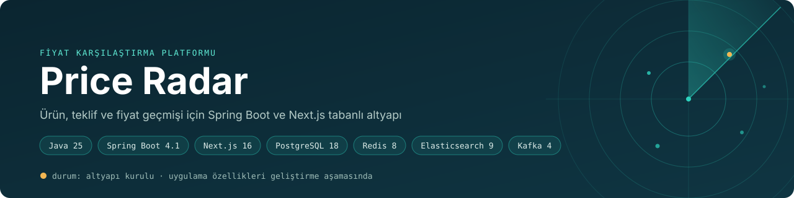
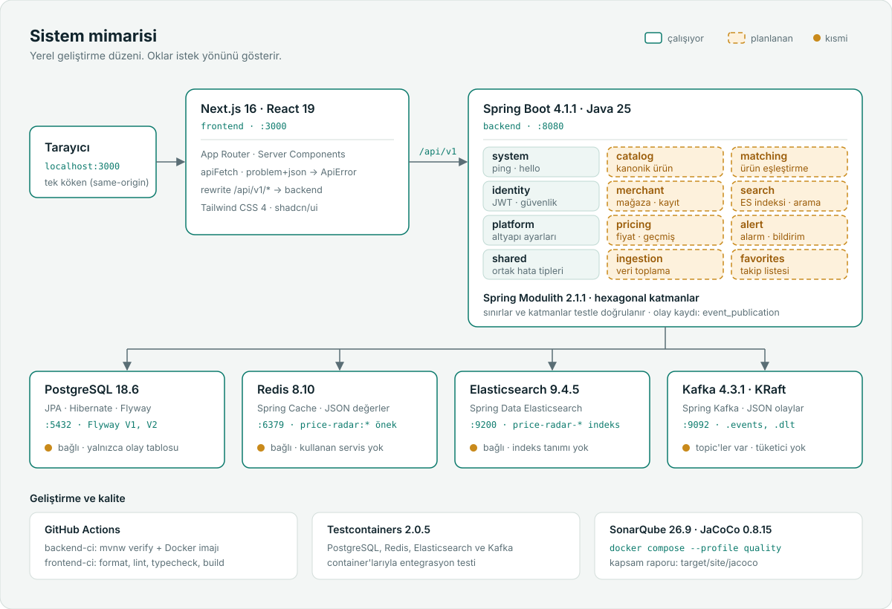
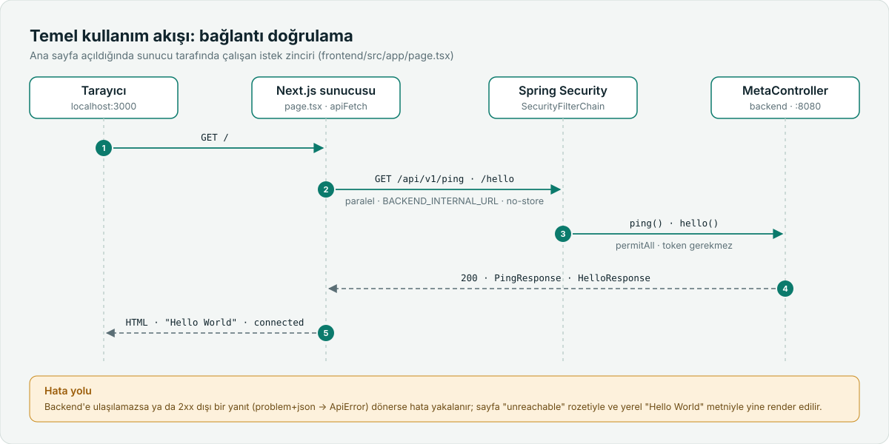
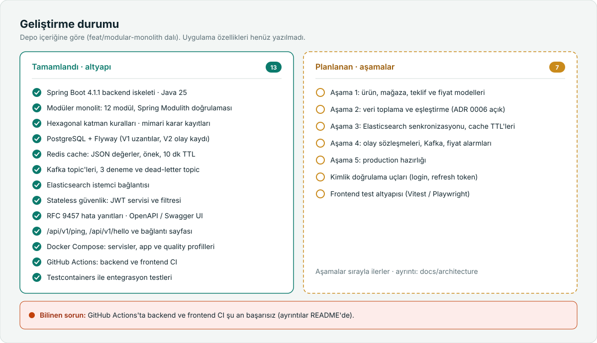

<p align="center">
  
</p>

<p align="center">
  <a href="#çözülen-problem">Problem</a> ·
  <a href="#özellikler-ve-modüller">Modüller</a> ·
  <a href="#teknoloji-yığını">Teknolojiler</a> ·
  <a href="#sistem-mimarisi">Mimari</a> ·
  <a href="#kurulum-ve-çalıştırma">Kurulum</a> ·
  <a href="#testler-ve-kalite-kontrolleri">Testler</a> ·
  <a href="#geliştirme-durumu">Durum</a>
</p>

**Price Radar**, farklı satıcılardaki ürün tekliflerini ve fiyat geçmişini tek yerde
toplamayı hedefleyen bir fiyat karşılaştırma platformudur. Depo şu anda bu platformun
**altyapı iskeletini** içerir: Spring Boot backend, Next.js frontend ve PostgreSQL, Redis,
Elasticsearch ve Kafka servisleri kurulu, yapılandırılmış ve birbirine bağlıdır.

> [!NOTE]
> Ürün, teklif ve fiyat geçmişi özellikleri henüz yazılmadı. Çalışan uçlar yalnızca
> bağlantı doğrulama uçlarıdır (`/api/v1/ping`, `/api/v1/hello`). Ayrıntılar:
> [Geliştirme durumu](#geliştirme-durumu).

## Çözülen problem

Aynı ürün birçok satıcıda farklı fiyatlarla satılır ve fiyatlar zamanla değişir. Tek tek
mağaza gezmek hem en uygun teklifi bulmayı hem de bir fiyatın gerçekten düşük olup
olmadığını anlamayı zorlaştırır. Price Radar bu teklifleri tek bir ürün altında toplayıp
fiyat geçmişiyle birlikte sunmayı amaçlar.

Bu hedef koddaki tanımlardan gelir (`pom.xml` açıklaması, OpenAPI başlığı
"Product, offer and price-history API", `next.config.ts` içindeki satıcı logosu notu).
Kurulu altyapı bu hedefin ihtiyaçlarıyla şöyle eşleşir:

| İhtiyaç | Kurulu altyapı |
|---|---|
| Farklı mağazalarda farklı yazılan ürün adlarını eşleştirmek | PostgreSQL `pg_trgm` (benzerlik) ve `unaccent` (aksan duyarsız arama) uzantıları |
| Hızlı ürün araması | Elasticsearch, ortam başına indeks öneki (`price-radar-*`) |
| Sık okunan verileri hafifletmek | Redis cache, 10 dakika varsayılan TTL |
| Fiyat değişimi gibi olayları bağımsız işlemek | Kafka olay topic'i ve işlenemeyen kayıtlar için dead-letter topic |

## Özellikler ve modüller

### Çalışan

| Modül | Konum | Ne yapar |
|---|---|---|
| Bağlantı uçları | `backend/.../common/web/MetaController.java` | `GET /api/v1/ping` servis adı, API sürümü ve sunucu zamanını döner. `GET /api/v1/hello` bir selamlama mesajı döner. İkisi de kimlik doğrulama istemez. |
| Hata yanıtları | `backend/.../common/web/GlobalExceptionHandler.java` | Tüm hataları RFC 9457 `application/problem+json` olarak döner. Doğrulama hataları alan bazında `errors` içinde gelir. |
| Güvenlik | `backend/.../security/` | Stateless filtre zinciri, HMAC imzalı JWT üretme ve doğrulama (`JwtService`), `Bearer` başlığını okuyan filtre, BCrypt parola kodlayıcı, CORS. Açık uçlar dışındaki her istek kimlik doğrulama ister. |
| Cache | `backend/.../config/CacheConfig.java` | Redis cache: JSON değerler, `price-radar:` anahtar öneki, 10 dakika TTL, `com.priceradar.*` ile sınırlı tip bilgisi. |
| Mesajlaşma | `backend/.../config/KafkaConfig.java` | Açılışta `price-radar.events` ve `price-radar.dlt` topic'lerini oluşturur. Listener hatalarında üstel beklemeyle 3 kez yeniden dener, sonra kaydı DLT'ye yazar. |
| Şema yönetimi | `backend/src/main/resources/db/migration/` | Flyway `V1__baseline.sql`: `pg_trgm` ve `unaccent` uzantıları. Hibernate şemaya dokunmaz (`ddl-auto: validate`). |
| API dokümantasyonu | `backend/.../config/OpenApiConfig.java` | Swagger UI ve OpenAPI JSON, Bearer şemasıyla. `prod` profilinde Swagger UI kapalıdır. |
| Frontend ana sayfa | `frontend/src/app/page.tsx` | Backend'e sunucu tarafında `ping` ve `hello` isteği atar, bağlantı durumunu ve kurulu katmanları gösterir. |
| API istemcisi | `frontend/src/lib/api/` | Tipli `apiFetch`, sorgu parametreleri, Bearer token, problem+json gövdesini taşıyan `ApiError`. |

### Planlanan

Bu başlıklar için henüz kod yok:

- JPA entity'leri ve repository'ler
- Kimlik doğrulama uçları (login, refresh token). OpenAPI açıklaması `POST /api/v1/auth/login`
  ucuna atıf yapıyor ama bu uç henüz yok.
- Ürün, teklif ve fiyat geçmişi API'leri
- Elasticsearch indeks tanımları
- Kafka olay tipleri ve `@KafkaListener` tüketicileri
- Frontend test altyapısı
- Deploy pipeline'ı (CI imajları derliyor ama hiçbir registry'ye push etmiyor)

## Teknoloji yığını

Sürümler `pom.xml`, `package.json`, `docker-compose.yml` ve çözümlenmiş bağımlılıklardan alınmıştır.

| Katman | Teknoloji | Sürüm |
|---|---|---|
| Backend | Java, Spring Boot | 25 · 4.1.1 |
| Frontend | Next.js, React, TypeScript | 16.3.8 · 19.2.8 · 5.9 |
| UI | Tailwind CSS, shadcn/ui (radix-nova), lucide-react | 4.3 · 4.21 |
| Veritabanı | PostgreSQL | 18.6 |
| ORM ve şema | Spring Data JPA, Hibernate, Flyway | Hibernate 7.4.5 · Flyway 12.4.0 |
| Cache | Redis (Lettuce istemcisi) | 8.10 |
| Arama | Elasticsearch, Spring Data Elasticsearch | 9.4.5 · 6.1.1 |
| Mesajlaşma | Apache Kafka (KRaft), Spring Kafka | 4.3.1 · 4.1.1 |
| Kimlik doğrulama | Spring Security, jjwt | 0.13.0 |
| API dokümantasyonu | springdoc-openapi | 3.1.1 |
| Test | JUnit Jupiter, Mockito, Testcontainers | 6.0.3 · 5.23.0 · 2.0.5 |
| Kod kalitesi | SonarQube Community, JaCoCo, ESLint, Prettier | 26.9 · 0.8.15 · 9 · 3.9 |
| Container ve CI | Docker Compose, GitHub Actions | |

## Sistem mimarisi

<p align="center">
  
</p>

- **Tek köken.** Tarayıcı yalnızca Next.js ile konuşur. `next.config.ts` içindeki rewrite
  `/api/v1/*` isteklerini backend'e iletir, böylece tarayıcı tarafında CORS gerekmez.
  Server Component'ler backend'e doğrudan `BACKEND_INTERNAL_URL` üzerinden gider.
- **Rewrite build sırasında sabitlenir.** `next build` yönlendirme hedefini routes
  manifest'e yazar. Bu yüzden Docker imajında `BACKEND_INTERNAL_URL` build argümanı
  olarak verilir; yalnızca çalışma zamanında vermek rewrite'ı değiştirmez.
- **Varsayılan olarak kapalı.** Yalnızca `/actuator/health/**`, `/actuator/info`,
  `/api/v1/ping`, `/api/v1/hello` ve API dokümantasyonu açıktır. Diğer actuator uçları
  `ADMIN` rolü ister, kalan her şey geçerli bir JWT ister.
- **Şemanın tek sahibi Flyway.** Her ortamda `ddl-auto: validate` kullanılır. Şema
  değişikliği yeni bir `V__*.sql` dosyasıdır; uygulanmış migration düzenlenmez.
- **Kafka topic'leri koddan gelir.** Broker'da otomatik topic oluşturma kapalıdır
  (`KAFKA_AUTO_CREATE_TOPICS_ENABLE=false`); yeni topic bir `NewTopic` bean'i demektir.
  JSON'a çevrilemeyen kayıtlar ham byte olarak DLT'ye yazılır.
- **Veri servisleri bağlı, henüz kullanılmıyor.** Dört servis de entegrasyon testlerinde
  yanıt veriyor, ancak şu an tablo, indeks, `@Cacheable` metodu veya Kafka tüketicisi yok.

### Temel kullanım akışı

Ürün özellikleri olmadığı için bugün uçtan uca çalışan akış, ana sayfanın backend
bağlantısını doğrulamasıdır.

<p align="center">
  
</p>

1. Tarayıcı `http://localhost:3000/` adresini ister.
2. Next.js sunucusu `GET /api/v1/ping` ve `GET /api/v1/hello` isteklerini paralel ve
   önbelleksiz (`cache: "no-store"`) gönderir.
3. Spring Security bu iki uca token istemeden izin verir; `MetaController` yanıtlar.
4. Backend `PingResponse` (`service`, `apiVersion`, `timestamp`) ve `HelloResponse`
   (`message`, `service`) döner.
5. Sayfa "Hello World" mesajı ve `connected` rozetiyle render edilir.

Backend'e ulaşılamazsa ya da 2xx dışı yanıt gelirse hata yakalanır. Sayfa yine açılır,
`unreachable` rozetini ve yerel "Hello World" metnini gösterir.

## Kurulum ve çalıştırma

### Gereksinimler

- **JDK 25+.** Maven Wrapper depoda var, ayrıca Maven kurmaya gerek yok.
- **Node.js 24+** (CI ve Docker imajı Node 24 kullanır).
- **Docker** ve Docker Compose. Veri servisleri ve entegrasyon testleri için gerekir.

### Yerel geliştirme

Veri servisleri container'da, backend ve frontend doğrudan makinede çalışır.

```bash
# 1. Ortam değişkenleri (Compose bu dosyayı okur)
cp .env.example .env

# 2. Veri servisleri: PostgreSQL, Redis, Elasticsearch, Kafka
docker compose up -d

# 3. Backend (ayrı terminal)
cd backend
./mvnw spring-boot:run

# 4. Frontend (ayrı terminal)
cd frontend
npm install
npm run dev
```

> [!IMPORTANT]
> `./mvnw spring-boot:run` kök dizindeki `.env` dosyasını **okumaz**. `.env.example`
> PostgreSQL parolasını `change-me` olarak verir, backend ise varsayılan olarak
> `price_radar` parolasını kullanır. İki yoldan birini seçin:
>
> - `.env` içinde `POSTGRES_PASSWORD=price_radar` bırakın, **ya da**
> - backend'i aynı parolayla başlatın: `POSTGRES_PASSWORD=<.env'deki değer> ./mvnw spring-boot:run`
>   (PowerShell: `$env:POSTGRES_PASSWORD="<değer>"; .\mvnw.cmd spring-boot:run`)
>
> PostgreSQL parolayı yalnızca veri dizini ilk oluşturulurken ayarlar. Değeri sonradan
> değiştirdiyseniz `docker compose down -v` ile volume'u silmeniz gerekir; bu işlem
> veritabanındaki tüm veriyi siler.

Frontend için ortam dosyası gerekmez; `frontend/src/lib/env.ts` yerel varsayılanları
kullanır (`BACKEND_INTERNAL_URL=http://localhost:8080`, `NEXT_PUBLIC_API_BASE_PATH=/api/v1`).
Farklı bir değer gerekirse `frontend/.env.local` oluşturun.

`JWT_SECRET` `dev` profilinde boş kalabilir; backend yalnızca geliştirme için tanımlı bir
anahtara düşer. `prod` profili bu değer olmadan açılmaz. Anahtar üretmek için:
`openssl rand -base64 48`.

### Adresler

| Servis | Adres |
|---|---|
| Frontend | http://localhost:3000 |
| Ping | http://localhost:8080/api/v1/ping |
| Hello | http://localhost:8080/api/v1/hello |
| Swagger UI (`prod` profilinde kapalı) | http://localhost:8080/swagger-ui.html |
| OpenAPI JSON | http://localhost:8080/v3/api-docs |
| Actuator health | http://localhost:8080/actuator/health |
| Elasticsearch | http://localhost:9200 |
| Kafka | `localhost:9092` |
| SonarQube (`quality` profili) | http://localhost:9000 |

### Her şeyi container'da çalıştırmak

```bash
docker compose --profile app up -d --build
```

`app` profili backend ve frontend imajlarını derleyip veri servisleri sağlıklı olduktan
sonra başlatır. Compose backend için bağlantı adreslerini kendisi kurar, bu yüzden
yukarıdaki parola uyarısı bu modda geçerli değildir.

### Sorun giderme

<details>
<summary><strong>5432 portu yerel bir PostgreSQL tarafından kullanılıyor</strong></summary>

Makinede kurulu bir PostgreSQL servisi 5432'yi tutuyorsa backend sessizce o servise
bağlanabilir ve `password authentication failed for user "price_radar"` hatasıyla
durur. Yerel servisi durdurun ya da container'ı başka porta alın:

```bash
# .env
POSTGRES_PORT=5433

docker compose up -d postgres
POSTGRES_URL=jdbc:postgresql://localhost:5433/price_radar ./mvnw spring-boot:run
```

Testcontainers rastgele port kullandığı için testler bu çakışmadan etkilenmez.
</details>

<details>
<summary><strong>Linux / macOS: <code>./mvnw: Permission denied</code></strong></summary>

`backend/mvnw` git'te çalıştırılabilir olarak işaretli değil (mod `100644`). Çözüm
olarak `chmod +x backend/mvnw` çalıştırın ya da `sh mvnw ...` kullanın.
</details>

<details>
<summary><strong>Temiz checkout'ta <code>npm run typecheck</code>: <code>Cannot find name 'LayoutProps'</code></strong></summary>

`LayoutProps` tipini Next.js `.next/types` altında üretir; bu dizin `next dev` ya da
`next build` çalışmadan önce yoktur. Typecheck'ten önce tipleri üretin:

```bash
npx next typegen
npm run typecheck
```
</details>

## Klasör yapısı

```text
price-radar/
├── backend/                         Spring Boot 4.1 · Java 25
│   ├── src/main/java/com/priceradar/
│   │   ├── common/exception/        404 ve 409'a karşılık gelen alan hataları
│   │   ├── common/web/              problem+json handler, /ping ve /hello
│   │   ├── config/                  Cache, Kafka, OpenAPI ve *Properties sınıfları
│   │   └── security/                SecurityConfig, JWT servisi ve filtresi
│   ├── src/main/resources/
│   │   ├── application.yml          ortak yapılandırma, ortam değişkenleriyle ezilir
│   │   ├── application-dev.yml
│   │   ├── application-prod.yml
│   │   └── db/migration/            Flyway sürümleri
│   ├── src/test/                    birim, web slice ve Testcontainers testleri
│   ├── pom.xml
│   └── Dockerfile                   çok aşamalı, katmanlı jar
├── frontend/                        Next.js 16 · React 19 · Tailwind 4
│   ├── src/app/                     App Router sayfaları
│   ├── src/components/ui/           shadcn/ui bileşenleri
│   ├── src/lib/api/                 tipli API istemcisi ve problem+json tipi
│   ├── src/lib/env.ts               ortam değişkenlerinin okunduğu tek yer
│   ├── sonar-project.properties
│   └── Dockerfile                   standalone çıktı
├── assets/readme/                   README görselleri (SVG)
├── .github/workflows/               backend-ci.yml, frontend-ci.yml
├── docker-compose.yml               veri servisleri + app ve quality profilleri
└── .env.example                     Compose için ortam değişkenleri şablonu
```

## Testler ve kalite kontrolleri

### Mevcut testler

Tüm testler backend'de; frontend'de henüz test yok.

| Test sınıfı | Tür | Test sayısı | Docker gerekir | Kapsam |
|---|---|---|---|---|
| `JwtServiceTest` | Birim | 5 | Hayır | Token üretme ve okuma, yabancı anahtar, yabancı issuer, süresi dolmuş token, boş rol listesi |
| `MetaControllerTest` | Web slice (`@WebMvcTest`) | 2 | Hayır | `/api/v1/ping` ve `/api/v1/hello` yanıt gövdeleri |
| `PriceRadarBackendApplicationTests` | Entegrasyon (Testcontainers) | 6 | Evet | Flyway migration'ı ve uzantılar, Redis `PING`, Elasticsearch ping, Kafka topic'leri, Kafka'ya JSON olay gönderme, cache yöneticisi |

Entegrasyon testleri `AbstractIntegrationTest`'ten türer ve tek bir Spring context ile
tek bir container setini paylaşır. İmaj etiketleri `TestcontainersConfiguration` içinde
sabittir ve `docker-compose.yml` ile aynıdır.

### Komutlar

```bash
# Backend
cd backend
./mvnw test       # tüm testler
./mvnw verify     # testler + JaCoCo raporu (target/site/jacoco/)

# Frontend
cd frontend
npm run format:check
npm run lint
npm run typecheck   # temiz checkout'ta önce: npx next typegen
npm run build
```

### Son yerel doğrulama

15 Ekim 2026, `main` (e30c187), Windows 11, JDK 26.0.1 (derleme hedefi `release 25`), Docker 29.6.1, Node.js 24.18.0:

| Kontrol | Sonuç |
|---|---|
| `./mvnw -B verify` | 13 test, 0 hata, 0 atlanan. `BUILD SUCCESS` |
| `npm run format:check` | Başarılı |
| `npm run lint` | Başarılı |
| `npm run typecheck` | Başarılı (`.next/types` mevcutken) |
| `npm run build` | Başarılı |

### CI

Durum, `main` üzerindeki son çalıştırmalardan alınmıştır (15 Ekim 2026, e30c187).

| İş akışı | Adımlar | Son durum |
|---|---|---|
| `backend-ci.yml` | `./mvnw verify`, test raporlarını yükleme, SonarQube (token varsa), Docker imajı build | **Başarısız**: `./mvnw: Permission denied` |
| `frontend-ci.yml` | `npm ci`, format, lint, typecheck, build, SonarQube (token varsa), Docker imajı build | **Başarısız**: typecheck'te `Cannot find name 'LayoutProps'` |

İki hatanın nedeni yukarıdaki [Sorun giderme](#sorun-giderme) bölümünde. İş akışları
yalnızca ilgili dizin değiştiğinde (`backend/**`, `frontend/**`) çalışır.

### SonarQube

```bash
docker compose --profile quality up -d
# http://localhost:9000 — ilk giriş admin/admin, parola değiştirmeniz istenir.
# Proje token'ı oluşturup kabuğunuzda SONAR_TOKEN olarak tanımlayın.

cd backend
./mvnw verify sonar:sonar -Dsonar.host.url=http://localhost:9000 -Dsonar.token=$SONAR_TOKEN
```

Sonar kapsamı `target/site/jacoco/jacoco.xml` üzerinden okur. JaCoCo
`config/**` paketini ve uygulama giriş sınıfını kapsam dışında tutar. Frontend tarama
ayarları `frontend/sonar-project.properties` içindedir ve CI'da
`sonarqube-scan-action` ile çalışır.

## Geliştirme durumu

<p align="center">
  
</p>

**Tamamlandı (altyapı)**

- Spring Boot 4.1.1 backend iskeleti, Java 25
- PostgreSQL ve Flyway V1 baseline (`pg_trgm`, `unaccent`)
- Redis cache yapılandırması
- Kafka topic'leri, yeniden deneme ve dead-letter topic
- Elasticsearch istemci bağlantısı
- Stateless güvenlik: JWT servisi ve filtresi
- RFC 9457 hata yanıtları, OpenAPI ve Swagger UI
- `/api/v1/ping`, `/api/v1/hello` ve frontend bağlantı sayfası
- Docker Compose: veri servisleri, `app` ve `quality` profilleri
- GitHub Actions iş akışları (backend, frontend)
- Testcontainers ile entegrasyon testleri

**Planlanan (uygulama, sıra belirlenmedi):** [Özellikler ve modüller](#planlanan) bölümündeki liste.

**Bilinen sorunlar**

- İki CI iş akışı da şu an başarısız ([CI](#ci)).
- `GlobalExceptionHandler` 401 ve 403 yanıtlarında `type` alanına `not-found` problem
  tipini yazıyor.
- `frontend/README.md` hâlâ `create-next-app` şablon metnini içeriyor.
