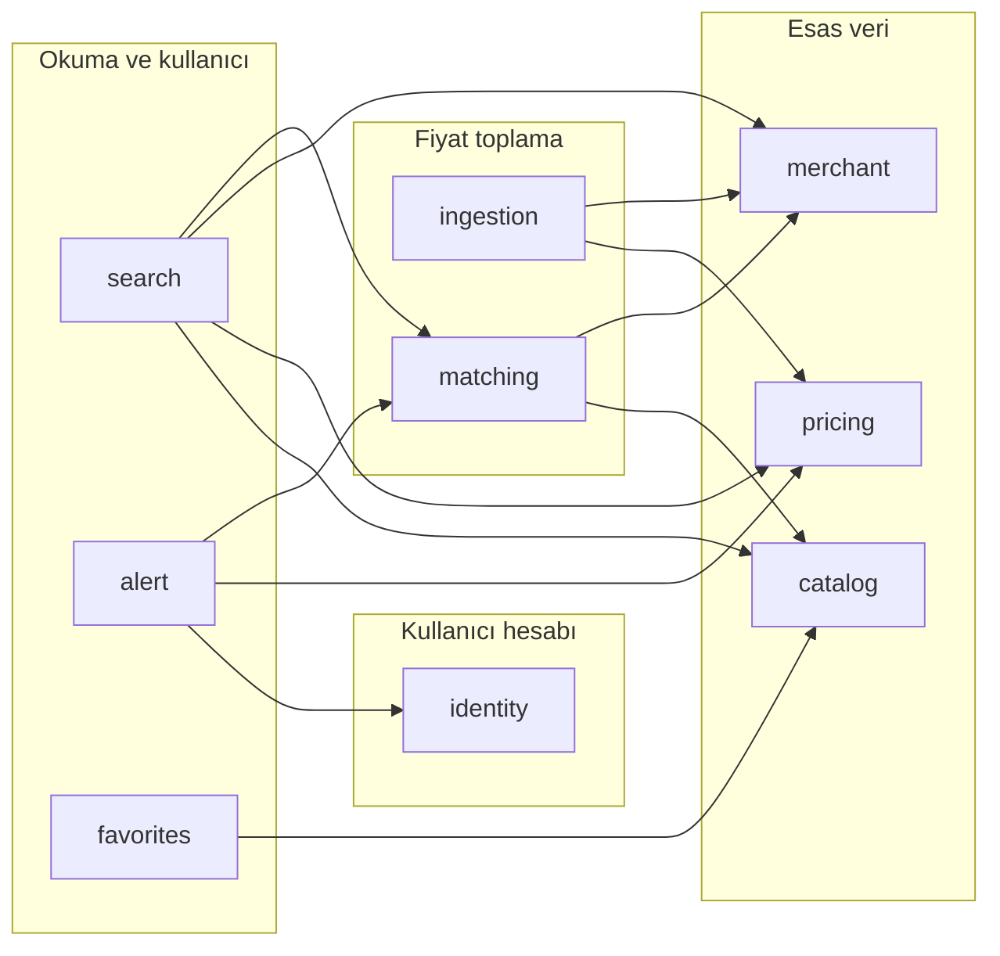
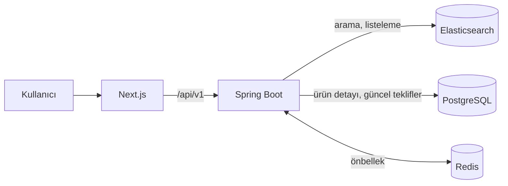
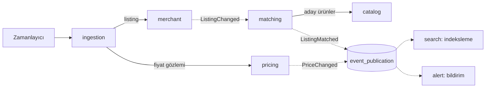

# Price Radar mimarisi

Bu klasör Price Radar'ın mimari kararlarını ve hedef yapısını tutar. Kod bu kararlara
göre yazılır; bir karar değişirse önce buradaki ilgili kayıt güncellenir.

Kısaca: **tek bir Spring Boot uygulaması**, içinde sınırları test ile korunan iş
modülleri, her modülün içinde hexagonal katmanlar, modüller arasında olaylar.
Mikroservis, Kubernetes, API Gateway veya servis keşfi şimdilik yok. Gerçek trafik
hangi parçanın ayrılması gerektiğini gösterdiğinde o parça ayrılır.

## Karar kayıtları

| No | Karar | Durum |
|---|---|---|
| [0001](adr/0001-modular-monolith.md) | Modüler monolit ve modül sınırları | Kabul edildi, kuruldu |
| [0002](adr/0002-hexagonal-modules.md) | Modül içinde hexagonal katmanlar | Kabul edildi, kuralları kuruldu |
| [0003](adr/0003-event-driven-integration.md) | Modüller arası olaylar ve transactional outbox | Kabul edildi, olay kaydı kuruldu |
| [0004](adr/0004-cqrs-lite.md) | CQRS Lite: PostgreSQL yazma, Elasticsearch okuma | Kabul edildi, uygulanmadı |
| [0005](adr/0005-product-and-price-model.md) | Ürün, teklif ve fiyat veri modeli | Kabul edildi, uygulanmadı |
| [0006](adr/0006-price-collection-and-matching.md) | Fiyat toplama yöntemi ve ürün eşleştirme | **Açık**: karar bekliyor |

"Kuruldu" kararın kodda ve testlerde yerinde olduğunu, "uygulanmadı" kararın
verildiğini ama ilgili iş kodunun henüz yazılmadığını gösterir.

## Modül haritası



Oklar "bağımlı olabilir" anlamına gelir: ya modülün API'sindeki bir servisi çağırır ya
da yayınladığı olayı dinler. Bu izinler her modülün `package-info.java` dosyasında
`allowedDependencies` ile yazılıdır; `ModularityTests` dışına çıkan her bağımlılıkta
build'i kırar. Döngü yoktur.

Altyapı modülleri haritada yok: `shared` (her modüle açık ortak tipler), `platform`
(cache, Kafka, OpenAPI yapılandırması), `system` (ping/hello) ve `identity` (JWT,
güvenlik). Hiçbiri iş modüllerine bağımlı değildir.

| Modül | Sorumluluk | Durum |
|---|---|---|
| `catalog` | Kanonik ürünler, markalar, kategoriler, özellikler | Planlanan |
| `merchant` | Mağazalar ve mağaza ürün kayıtları (listing) | Planlanan |
| `pricing` | Fiyatlar, indirimler, fiyat geçmişi | Planlanan |
| `ingestion` | Mağaza entegrasyonları ve veri toplama | Planlanan |
| `matching` | Aynı ürünün farklı mağazalarda eşleştirilmesi | Planlanan |
| `search` | Elasticsearch indeksi ve arama | Planlanan (yalnızca `SearchProperties`) |
| `identity` | Kullanıcılar, oturumlar, yetkilendirme | JWT ve güvenlik zinciri çalışıyor; kullanıcı alanı planlanan |
| `alert` | Fiyat alarmları ve bildirimler | Planlanan |
| `favorites` | Favoriler ve takip listeleri | Planlanan |

## İki ana akış

**Okuma.** Ürün araması ve listeleme Elasticsearch'ten gelir. Ürün detayı ve güncel
teklifler PostgreSQL'den okunur. Redis sık okunan sonuçları önbelleğe alır.



**Yazma (fiyat toplama).** Zamanlanmış işler mağazalardan veriyi alır, normalize eder
ve PostgreSQL'e yazar. Fiyat değiştiyse olay yayınlanır. Arama indeksi ve alarmlar
bu olaydan sonra, API isteğini bekletmeden güncellenir.



Kesikli oklar olaydır. Olay, yazan işlemle aynı veritabanı işleminde
`event_publication` tablosuna kaydedilir ([ADR 0003](adr/0003-event-driven-integration.md)).
Olay adları örnektir; sözleşmeler ilgili modül yazılırken kesinleşir.

## Modül içi yapı

Her iş modülü aynı şablonu izler ([ADR 0002](adr/0002-hexagonal-modules.md)):

```text
com.priceradar.catalog/
├── package-info.java      @ApplicationModule: sorumluluk ve izinli bağımlılıklar
├── CatalogQueries.java    modül API'si: diğer modüllerin çağırabileceği arayüzler
├── ProductCreated.java    modül API'si: yayınlanan olaylar
├── domain/                saf iş modeli ve kurallar; Spring, JPA, Kafka yok
│   ├── model/
│   └── port/              dış dünyaya açılan arayüzler (ör. ProductRepository)
├── application/           kullanım senaryoları
│   ├── command/           yazma işlemleri
│   └── query/             okuma işlemleri
├── infrastructure/        çıkış adaptörleri: JPA, Elasticsearch, Kafka, dış API'ler
│   └── persistence/
└── web/                   giriş adaptörü: REST controller'lar ve DTO'lar
```

Dosya adları örnektir. Katman klasörleri, içine ilk sınıf yazıldığında açılır; kurallar
o andan itibaren `HexagonalArchitectureTests` ile denetlenir.

## Geliştirme sırası

| Aşama | Kapsam | Durum |
|---|---|---|
| 1. Temel domain mimarisi | Modüler monolit, hexagonal kurallar, olay kaydı | Mimari kuruldu |
| | Ürün, mağaza, teklif ve fiyat geçmişi modelleri | Sırada ([ADR 0005](adr/0005-product-and-price-model.md)) |
| 2. Veri toplama | İzinli mağaza API'leri ve feed'ler, normalizasyon, eşleştirme, hatalı veri kontrolü | [ADR 0006](adr/0006-price-collection-and-matching.md) kararını bekliyor |
| 3. Arama ve performans | Elasticsearch senkronizasyonu, cache politikaları, arama ve filtreleme | Bekliyor |
| 4. Olay güdümlü süreçler | Olay sözleşmeleri, Kafka'ya dışsallaştırma, fiyat alarmları, bildirim işleri | Bekliyor (outbox altyapısı hazır) |
| 5. Production hazırlığı | Rate limiting, gözlemlenebilirlik, yedekleme, yük testleri, CI/CD | Bekliyor |

## Denetim

| Test | Neyi korur |
|---|---|
| `ModularityTests` | Modüller arası döngü, başka modülün iç paketine erişim, beyan edilmemiş bağımlılık |
| `HexagonalArchitectureTests` | Modül içi katman yönü, framework'süz domain, adaptör sızdırmayan modül API'si, JPA entity, Kafka listener ve controller yerleşimi |

İkisi de Docker gerektirmez ve her `./mvnw test` çalışmasında koşar. Modül
diyagramları `backend/target/spring-modulith-docs/` altına üretilir.
