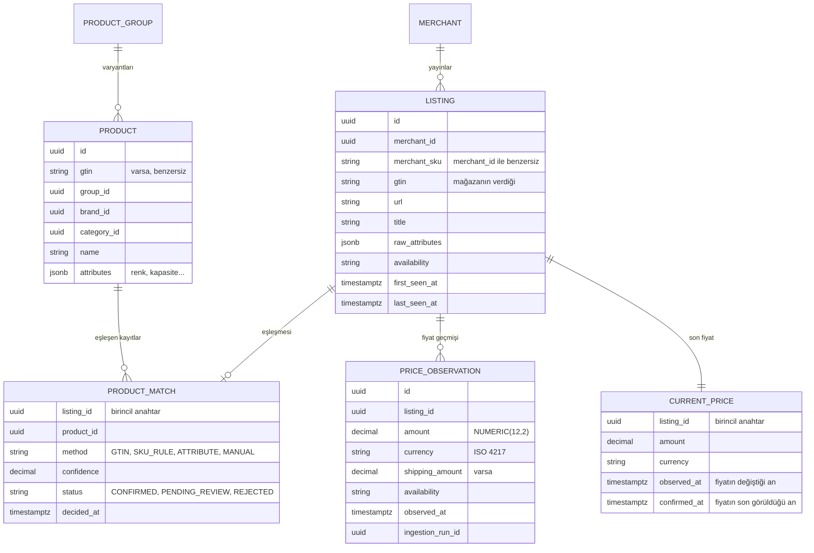

# 0005. Ürün, teklif ve fiyat veri modeli

- **Durum:** Kabul edildi, uygulanmadı
- **Tarih:** 2026-10-15

## Bağlam

Aynı telefonu beş mağaza satıyorsa sistemde beş ayrı ürün olmamalıdır. Aksi halde
karşılaştırma yapılamaz, fiyat geçmişi parçalanır ve alarm doğru ürüne bağlanamaz.
Mağazalar aynı ürünü farklı isim, farklı SKU ve bazen farklı varyant bilgisiyle
yayınlar. Fiyatlar zamanla değişir ve geçmişi güvenilir biçimde saklanmalıdır.

## Karar

### Kavramlar

| Kavram | Modül | Anlamı |
|---|---|---|
| Kanonik ürün (`Product`) | `catalog` | Satın alınabilir tek bir varyant: "iPhone 16, 128 GB, siyah". GTIN varsa onunla tanımlanır. |
| Ürün grubu (`ProductGroup`) | `catalog` | Varyantları bir araya getirir: "iPhone 16". Arayüzde gruplama için kullanılır, fiyat taşımaz. |
| Mağaza (`Merchant`) | `merchant` | Fiyat toplanan satıcı. |
| Mağaza kaydı (`Listing`) | `merchant` | Bir mağazanın bir ürün için yayınladığı kayıt: SKU, GTIN, URL, başlık, ham özellikler, stok durumu. Teklif budur. |
| Eşleşme (`ProductMatch`) | `matching` | Bir mağaza kaydının hangi kanonik ürün olduğu, nasıl ve ne güvenle karar verildiği. |
| Fiyat gözlemi (`PriceObservation`) | `pricing` | Bir mağaza kaydının belirli bir anda görülen fiyatı. Değiştirilmez. |
| Güncel fiyat (`CurrentPrice`) | `pricing` | Her mağaza kaydının son fiyatı. Gözlemlerden türetilir, okuma için tutulur. |

Diyagram modüller arası ilişkileri de gösterir; bu ilişkiler veritabanında yabancı
anahtar değil, kimlik değeridir (aşağıya bakın). Alan listesi başlangıç önerisidir;
tablolar her modül yazılırken Flyway migration'ı ile kesinleşir.

### Kurallar

- **Mağaza kaydı ürüne doğrudan bağlanmaz.** `Listing` kanonik ürün kimliği taşımaz;
  bağ `ProductMatch` üzerinden kurulur. Yanlış eşleşme düzeltildiğinde yalnızca
  eşleşme kaydı değişir, fiyat geçmişi yerinde kalır.
- **Fiyat geçmişi mağaza kaydına bağlıdır, ürüne değil.** Bir ürünün geçmişi, ona
  eşleşen kayıtların geçmişinden türetilir. Eşleşme değişince geçmiş doğru ürüne
  kendiliğinden geçer.
- **Fiyat gözlemi yalnızca değişimde yazılır.** Fiyat, para birimi, kargo ücreti veya
  stok durumu öncekinden farklıysa yeni `PriceObservation` eklenir. Aynıysa yalnızca
  `CurrentPrice.confirmed_at` güncellenir. Her toplama turunu satır olarak yazmak
  yüzlerce mağaza ve saatlik toplamada günde yüz milyonlarca satıra ulaşır.
  Değişim noktaları ve son görülme zamanı geçmişi aynı doğrulukla anlatır.
- **Gözlemler değiştirilmez ve silinmez.** Hatalı veri bir düzeltme gözlemiyle
  kapatılır; geçmiş yeniden yazılmaz.
- **Para her zaman tutar ve para birimiyle birlikte saklanır.** Veritabanında
  `NUMERIC(12,2)` ve ISO 4217 kodu, domain'de `Money` değer nesnesi (`BigDecimal` ve
  `Currency`). `double` kullanılmaz. Farklı para birimleri dönüştürülmeden
  karşılaştırılmaz.
- **Zaman UTC saklanır** (`TIMESTAMP WITH TIME ZONE`; Hibernate zaten
  `time_zone: UTC` ile yapılandırılmış). `observed_at` mağazadan verinin alındığı
  andır, satırın yazıldığı an değil.
- **Kimlikler UUID'dir.** Modüller birbirinin kaydına yalnızca kimlikle atıf yapar.

### Veritabanı düzeni

- **Her modülün kendi PostgreSQL şeması vardır:** `catalog`, `merchant`, `matching`,
  `pricing`, `identity`, `alert`, `favorites`. Bir modül başka şemadaki tabloya SQL
  ile erişmez; bu, Java tarafındaki modül sınırının veritabanındaki karşılığıdır.
- **Yabancı anahtarlar yalnızca şema içinde tanımlanır.** Modüller arası atıflar
  kimlik değeridir; tutarlılık olaylarla sağlanır. Böylece bir modül ileride ayrı
  veritabanına taşınabilir.
- `event_publication` tablosu Spring Modulith'e aittir ve `public` şemada kalır.
- Fiyat gözlemi tablosu en hızlı büyüyecek tablodur. Ay bazlı bölümleme
  (partitioning) gerektiğinde eklenecek; ilk sürümde gerekmez.

## Sonuçlar

- Karşılaştırma, geçmiş ve alarm her zaman kanonik ürün üzerinden yapılır; aynı
  ürünün iki mağazadaki fiyatı aynı sayfada yan yana gelir.
- Eşleştirme hatası düzeltilebilir ve geçmişi bozmaz.
- Ürün düzeyindeki sorgular (en düşük fiyat, fiyat geçmişi grafiği) eşleşme ile
  gözlemlerin birleşimini gerektirir. Bu birleşim `search` okuma modelinde veya
  `pricing` sorgu tarafında yapılacak; karar ilk ürün sayfası yazılırken verilecek
  ([ADR 0001](0001-modular-monolith.md)).
- Varyant ayrımı (renk, kapasite) eşleştirmenin doğruluğuna bağlıdır
  ([ADR 0006](0006-price-collection-and-matching.md)).
